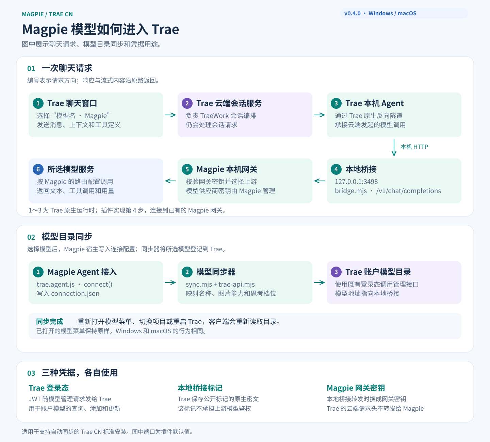
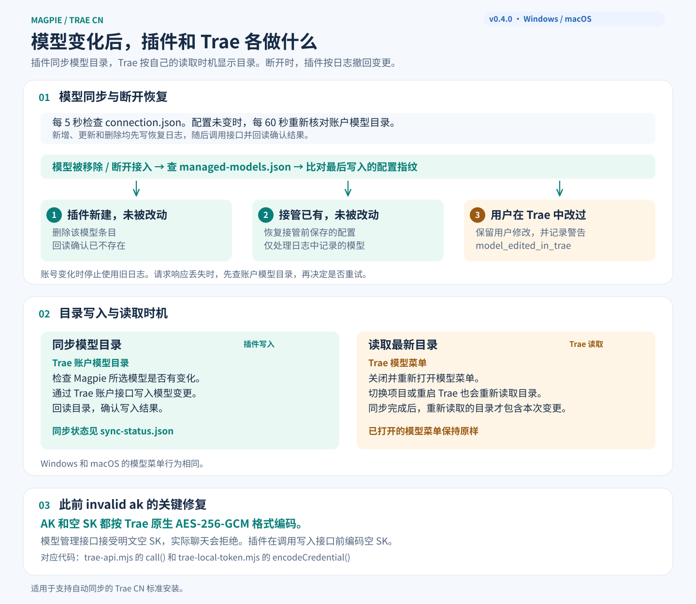

# Magpie Agent for Trae CN

[中文](README.md)

Use Magpie models and routing groups from Trae CN’s model picker. Automatically synced entries end in `· Magpie`. This guide covers plugin version 0.4.0.

## Compatibility

Native sync requires a verified Trae CN build and a standard installation path. Use manual setup for moved or custom installations. The sync process checks client file hashes before writing model entries. Use manual setup if a build fails those checks, even if its version is listed below.

| Platform and Trae CN version | Integration | Validation |
| --- | --- | --- |
| Windows 3.4.18 | Native sync on standard installs | Catalog sync and DeepSeek chat were verified in 0.3.x. |
| Windows 3.4.20 | Native sync on standard installs | Model creation, updates, deletion, and readback were verified in 0.3.x. |
| Windows 3.4.24 | Native sync on standard installs | In 0.4.0, credentials and the sign-in session were verified. A temporary model was added, listed, and deleted using a real account, and the test entry was cleaned up. |
| macOS 3.4.20 | Native sync on standard installs | The reviewer verified model addition and removal, confirmed that client files were unchanged, and verified that the application’s code signature remained valid. |
| macOS 3.4.24 and other unlisted versions or builds | Manual setup | Native sync is unverified. |
| Linux | Desktop integration is unverified | CI runs portable unit tests. |

The standard Windows path is `%LOCALAPPDATA%\Programs\Trae CN`. On macOS, the standard locations are `/Applications/Trae CN.app` and `~/Applications/Trae CN.app`. Set `TRAE_APP` to the resources directory containing `product.json` if you need to point the plugin to a specific installation. Custom paths use manual mode. Thanks to CN-P5 for sharing the Windows multi-drive discovery approach in [Magpie Trae Evergreen](https://github.com/CN-P5/magpie-trae-evergreen).

## Installation

Install and sign in to Trae CN, then configure a working model in Magpie. Install the plugin with this command.

```sh
magpie plugin add "github:lmy414/magpie-agent-trae#v0.4.0"
```

You can also download the release source, extract it, and run `magpie plugin add .` from the extracted directory. [Releases](https://github.com/lmy414/magpie-agent-trae/releases)

Enable Trae on Magpie’s Agents page. If Trae is hidden, expand the remaining agents at the bottom of the list. The plugin uses `dir: '~/.trae-cn'` for discovery on Windows and macOS. `~/.trae-cn` is Trae’s cross-platform product data directory.

### Native sync

Once the initial sync finishes, open Trae’s model picker and select an entry ending in `· Magpie`. Installation requires no Trae restart.

**An already-open picker keeps its current list.** After adding or removing a model in Magpie, wait for sync to finish, then close and reopen the picker. Switching projects or restarting Trae also makes Trae re-read the catalog. This behavior applies on both Windows and macOS.

### Manual setup

Run `magpie-trae setup` for the local bridge URL and token, then `magpie-trae models` for the available model IDs. From a source checkout, you can use `node cli.mjs setup` and `node cli.mjs models`.

Under **Settings → Models** in Trae, add an OpenAI Chat Completions custom model, enable the full URL option, and enter the bridge URL, local token, and model ID. Add, edit, or remove these entries in Trae’s settings. [Trae model settings](https://docs.trae.cn/work_models)

Keep Magpie running and Trae signed in. Restart Magpie after moving or upgrading Trae so the plugin can detect the installation again. Install only one of the standalone and community packages to avoid two runtimes managing the same configuration.

## Features

Catalog and capability sync, along with cleanup on model removal or disconnect, apply to builds with native sync. Manually configured models can also use the local bridge.

| Feature | Behavior |
| --- | --- |
| Model catalog | Syncs Magpie models and routing groups for selection in Trae |
| Model capabilities | Syncs image support, context length, output length, and reasoning effort levels |
| Request forwarding | Preserves streaming, images, tool calls, and reasoning parameters |
| Catalog updates | Writes to the Trae account catalog and reads it back. Trae re-reads the catalog when you reopen the picker, switch projects, or restart Trae |
| Removal and disconnect | Deletes unedited entries the plugin created and restores the previous configuration of entries it adopted |
| Library | Syncs selected rules, skills, and MCP servers from Magpie Library. On macOS, only rules and skills sync automatically |

Image support, tool calls, and reasoning depend on the upstream model. The bridge passes through upstream errors such as expired plans, rate limits, and insufficient balances.

### macOS Library limitation

`$APPDATA` is empty on macOS, so `$APPDATA/Trae CN/User/mcp.json` expands to the absolute path `/Trae CN/User/mcp.json`. Magpie hits a read-only filesystem error when it tries to create `/Trae CN`, so it cannot write the MCP configuration automatically. Rules and skills use `~/.trae-cn` and still sync.

## How it works

The diagram shows how 0.4.0 routes chat requests, syncs the catalog, and uses credentials. Trae reads the synced catalog when you reopen the model picker, switch projects, or restart Trae. Diagram labels are in Chinese.



### How models reach Trae

`connect()` returns the Magpie gateway URL, key, and selected model capabilities. The Magpie host writes them to `~/.config/magpie-trae/connection.json`. Trae’s discovery directory is separate, so clearing the model selection leaves that directory in place. [`trae.agent.js`](trae.agent.js)

The sync process converts selected models to Trae custom model entries and writes them to Trae’s account service. The entries point to the local bridge. The plugin calls the model management API using the existing local Trae session and leaves Trae’s SQLite model cache untouched. [`sync.mjs`](sync.mjs), [`trae-api.mjs`](trae-api.mjs)

Trae requires its native encoding for the local token and the empty secret key (SK). The plugin checks the SHA-256 hashes of two installed native libraries (DLLs on Windows and dynamic libraries on macOS) and reads the encoding parameters from them. The package excludes Trae’s libraries and embedded keys. [`trae-local-token.mjs`](trae-local-token.mjs)

### How chat requests are forwarded

Trae’s cloud still orchestrates TraeWork sessions. Model requests reach the local bridge through Trae’s reverse tunnel, then Magpie calls the upstream according to its provider and routing configuration.

The bridge listens on `127.0.0.1:3498` by default and accepts only local requests. It rejects browser `Origin` headers and checks the local `Host`, local token, and selected model ID. It forwards with the Magpie gateway key and preserves the request body and response stream. If the downstream connection closes early, the bridge closes the corresponding upstream request. [`bridge.mjs`](bridge.mjs)

### Sync and rollback

The diagram shows how the plugin syncs models, when Trae reads the catalog, and how the plugin rolls back changes on model removal or disconnect. Diagram labels are in Chinese.



The sync process checks the connection configuration every 5 seconds. If the configuration stays the same, it rechecks the Trae account catalog every 60 seconds. API requests and readback take additional time. [`sync.mjs`](sync.mjs)

The plugin records each pending write before calling the API, then verifies it by reading the catalog. If a response is lost, the next sync checks the catalog before deciding whether to retry. On removal or disconnect, the plugin acts only on entries in the journal. It preserves user-edited entries and reports `model_edited_in_trae`. If the account changes, the plugin stops using the old account’s journal.

## Rollback and uninstall

- For manual setup, disable Trae in Magpie and remove unwanted manual entries under **Settings → Models** in Trae before uninstalling.
- For native sync, disable Trae in Magpie and wait for the sync status to become `disconnected` before uninstalling. Keep `managed-models.json` until rollback finishes.

### Legacy client cleanup

Version 0.4.0 leaves Trae client files untouched at runtime. The plugin’s only client-file operation is explicit cleanup of 0.3.x leftovers.

Older Windows installs may have a loader appended to `out/main.js`. For a standard Windows install, run `node cli.mjs restore-client` from a source checkout. The command removes the loader suffix only if it exactly matches the old version and deletes `out/magpie-model-refresh.cjs`. On macOS, the command reports `not_needed`.

## Sessions and usage

Magpie records bridge requests under `trae-local`. The bridge maps a valid session ID to `X-Magpie-Session` so usage can be grouped across models within the same session. Requests without an ID count individually. The bridge does not import Trae’s local history. Magpie settings control conversation text recording.

After a request, run `node cli.mjs status` to see `lastRequest.sessionHeader`. The field shows the header name the bridge recognized. `null` means the request had no usable session header.

## Diagnostics

Run `magpie-trae status` for bridge and sync status, and `magpie-trae models` for models available through the bridge. From a source checkout, you can use `node cli.mjs status` and `node cli.mjs models`.

| File | Location |
| --- | --- |
| Connection configuration | `~/.config/magpie-trae/connection.json` |
| Model recovery journal | `managed-models.json` in the same directory |
| Sync status | `sync-status.json` in the same directory |

`~` denotes the current user’s home directory, which is `%USERPROFILE%` on Windows. `node cli.mjs restore-client` is only for the separate cleanup of 0.3.x Windows leftovers. To roll back model configuration, follow the uninstall steps above.

Connection configuration and recovery journals may contain credentials. For issue reports, share the plugin and Trae versions, error codes, and status information with credentials removed.

## Development and validation

Version 0.4.0 passed 64 unit tests on Node.js. Run `npm test` with Node.js 20 or later. No npm dependencies are required. Use `npm pack` to check the package contents.

`npm run acceptance` requires a local Magpie installation and its Bun host. The script uses a temporary home and local test servers to check Agent registration, catalog changes, forwarding, and Library restoration. It does not call real model accounts.

The long-session `3003 / SSE finish` error remains open in 0.4.0. Diagnostics observed failed continuation after a tool result was submitted and HTTP 500 responses from Trae’s cloud. The root cause is unconfirmed.

## License and sources

The project uses the MIT license and ships without Trae client files. See the license, the attribution for the reused community login-state decoder, and the notice for the Trae icon. [LICENSE](LICENSE), [THIRD_PARTY.md](THIRD_PARTY.md), [ASSET_NOTICE.md](ASSET_NOTICE.md)

The adapter uses Magpie’s Agent interface and references the community plugins. [Magpie Agent docs](https://usemagpie.ai/docs/plugins#agents), [Magpie community plugins](https://github.com/magpie-community/plugins)
